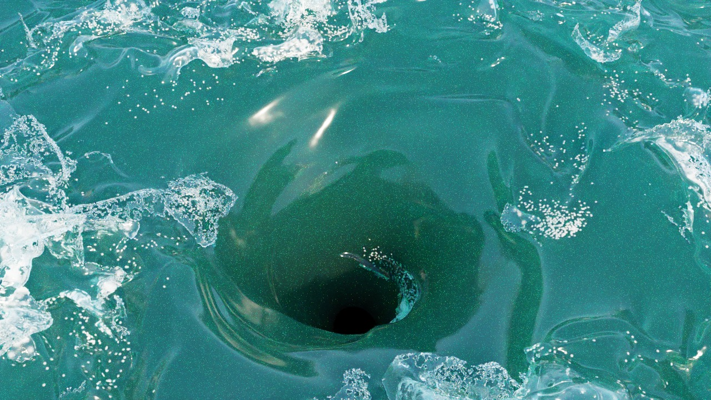
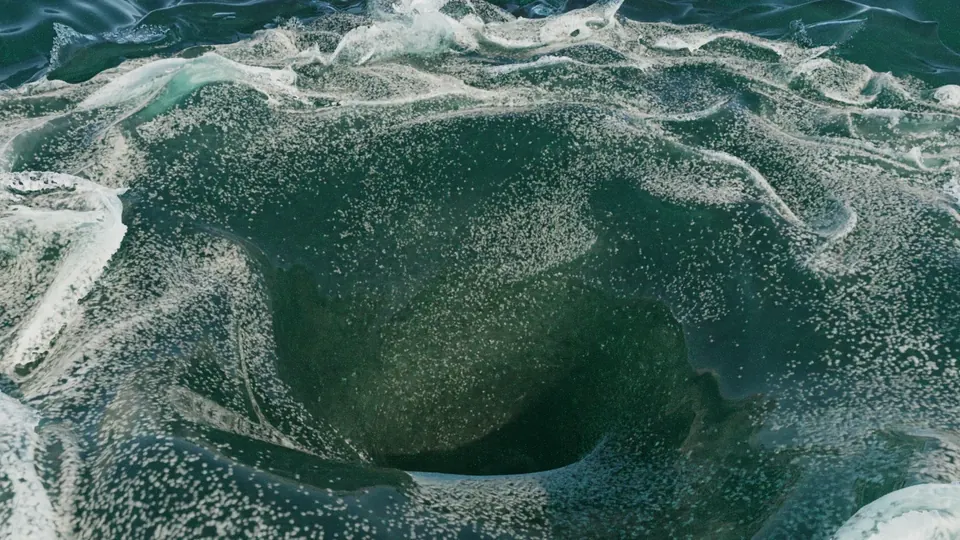
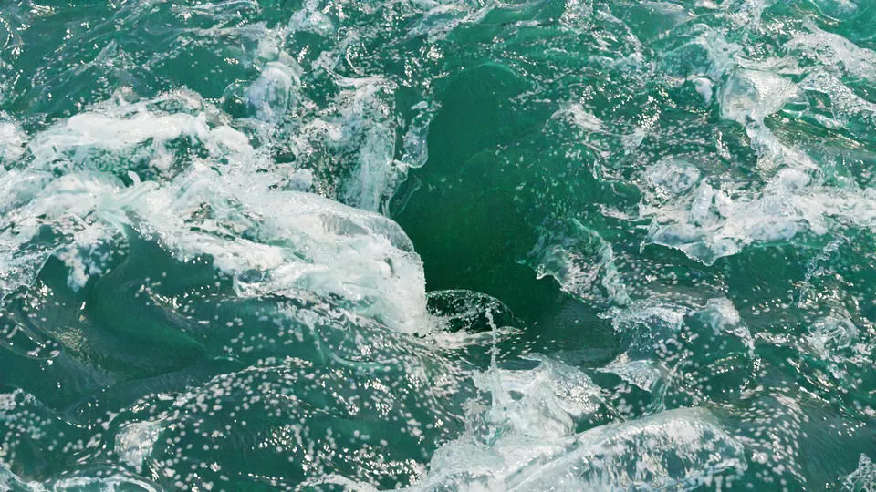

# Maelstrom.jl

Liquids on the GPU through [Mantle](https://github.com/SimonDanisch/Mantle.jl), simulated
the way film water is: particles where the surface is, a grid where it is not, and time
steps the flow sets.

<p align="center">
  
</p>
<p align="center"><sub>Frame 87 of a sparse FLIP whirlpool on a 5 cm grid, rendered with
<a href="https://github.com/MakieOrg/Makie.jl/tree/sd/lava-refactor/RayMakie">RayMakie</a>
at 1280×720 and 400 samples per pixel in 11 minutes on an AMD Radeon 8060S.</sub></p>

<table>
  <tr>
    <td width="50%"></td>
    <td width="50%"></td>
  </tr>
  <tr>
    <td><sub>A whirlpool in a rough tidal race: 2 s of consecutive simulation frames, none
    interpolated. 720p, 400 samples per pixel, shown here at 960 px.</sub></td>
    <td><sub>Two wave systems crossing over the vortex: 16 consecutive frames, 6.0–6.6 s.
    720p, 256 samples per pixel, shown here at 960 px.</sub></td>
  </tr>
</table>

## What it does

- **Narrow-band FLIP** (Ferstl et al. 2016) with APIC transfers (Jiang et al. 2015) and
  spatiotemporal steps (ST-FLIP, Braun et al. 2026), so a step can cross many cells.
- **Two grids:** a dense MAC grid (`FlipBasin`), and a sparse two-resolution block grid
  (`SparseBasin`, after Braun, Bender & Thuerey 2025): 16³ fine blocks where the surface
  is, a grid four times coarser elsewhere.
- **Pressure:** multigrid-preconditioned conjugate gradient, with flexible GMRES when the
  V-cycle is not a usable CG preconditioner.
- **Swirl that survives big steps:** on the sparse grid, advection–reflection (Zehnder et
  al. 2018) keeps a vortex turning at one step per frame.
- **Whitewater:** spray, foam and bubbles from the Ihmsen et al. 2012 model, made live
  from the solver's particles every frame.
- **Bakes and checkpoints:** particle, level-set and whitewater frames on disk, and
  portable checkpoints that restore into a larger block pool.

The scene it simulates today is a basin holding a whirlpool in a tidal race: `Basin`
holds the vortex and the forcing band at the rim, and `Stir` / `SurfaceStir` relax the
water to the swirl with the sea's waves in it and stir it with the race's eddies.

## Performance

Four seconds of the same whirlpool, simulated from the same starting vortex by
[TrixiParticles](https://github.com/trixi-framework/TrixiParticles.jl) (weakly compressible
SPH) and by Maelstrom, on one AMD Radeon 8060S (the Strix Halo laptop GPU), every frame
written to disk:

| Problem | TrixiParticles | Maelstrom, dense grid | Speedup | Maelstrom, sparse grid | Speedup |
|---|---|---|---|---|---|
| Naruto-sized basin, 10 m radius, at 10 cm | 5.2 min | 9.7 s | 32× faster | 59 s | 5× faster |
| Naruto-sized basin, 10 m radius, at 5 cm | 71 min | 65 s | 66× faster | 2.5 min | 29× faster |
| Film basin, 18 m radius and 12 m deep, at 10 cm | 91 min | 81 s | 67× faster | 2.7 min | 33× faster |

SPH fills the whole basin with particles and steps at the speed of sound; FLIP keeps
particles only in a band at the surface, the deep water on a grid, and steps with the
flow. Kernel compilation is excluded. In the Naruto basin all three funnels end within
0.2 m of each other. In the deep film basin the dense grid's funnel stays shallower
(9.0 m against SPH's 11.9 m): without advection–reflection it loses spin at one step per
frame. The sparse grid keeps its throat open to the floor, as SPH's nearly is.

TrixiParticles is not a slow reference: on the SPHERIC dam break (3 M particles, RTX 4000
Ada) it finishes in 17 minutes, DualSPHysics 5.4 in 25 minutes on the same GPU.

## Rendering with RayMakie

The pictures above were path traced with
[RayMakie](https://github.com/MakieOrg/Makie.jl/tree/sd/lava-refactor/RayMakie), the GPU
path tracer for [Makie](https://github.com/MakieOrg/Makie.jl), built on
[Hikari](https://github.com/JuliaGraphics/Hikari.jl). The water surface is a NanoVDB level
set rebuilt from the bake's particles every frame, and the foam, bubbles and spray are
volumes inside physically based seawater, lit by a sun and sky. Any Makie scene renders
the same way, on the same Vulkan GPUs Maelstrom runs on.

Converting bakes for rendering is not part of this package yet; these frames went
through the converter of the film project Maelstrom came from.

## Use

```julia
using Mantle, Maelstrom
backend = Mantle.defaultbackend()

b = narutobasin(; radius = 18f0, depth = 12f0, Γ = 225f0, core = 2.5f0)
stir = SurfaceStir(b, narutowaves(); race = Race(; eddy = 3f0))
s = SparseBasin(b, backend; dx = 0.05f0, stir, cfl = 4f0)
initialize!(s)

white = Whitewater(wild_drawn_basin(s), backend; rules = WhitewaterRules())
advance_wild!(s, white, "bake"; tend = 10, snapshots = (8, 10))
```

## Notes

- Everything a step does runs on the device; there is no host backend.
- Mantle depends on GLFW, so precompiling needs a display (`DISPLAY`) even for headless
  simulation.
